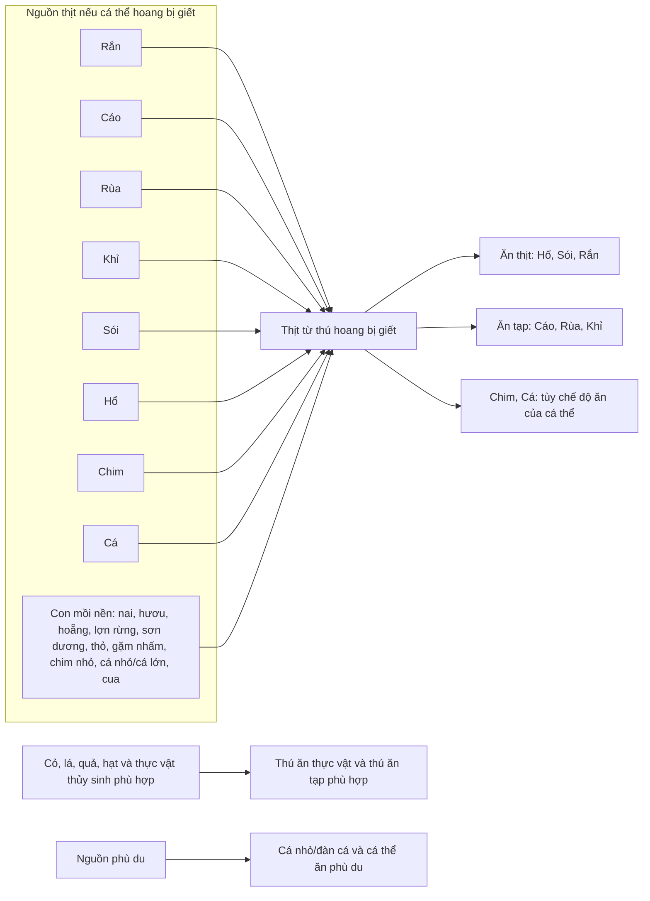
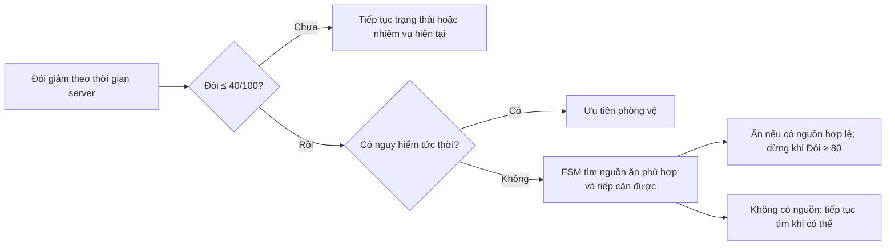

# Tiên Tộc Alpha 2.0 — Sơ đồ thức ăn

**Trạng thái:** Quan hệ thức ăn, ngưỡng tìm ăn/tìm nước và thứ tự chọn nguồn đã được Product Owner xác nhận; số miếng thịt, lượng hồi Đói/Khát và sản lượng từ xác thú vẫn TBD.

Sơ đồ [chuỗi thức ăn do Product Owner cung cấp](../food_chain_diagram.drawio) ghi các quan hệ **có thể ăn**. Trong Alpha, áp dụng sơ đồ khái quát dưới đây: cả tám nhóm thú có thể chiêu mộ, khi còn hoang, đều có thể trở thành con mồi nếu bị giết. Mũi tên chỉ khả năng tạo/ăn thịt, **không** có nghĩa thú luôn tìm hoặc luôn tấn công loài ở đầu mũi tên. Khả năng giết được mục tiêu, tiếp cận nguồn thức ăn và chế độ ăn của cá thể vẫn phải hợp lệ.

## Quy tắc kích hoạt hành vi

- Ngưỡng **Đói ≤ 40/100** áp dụng cho mọi thú sống có thể tự kiếm ăn, gồm thú gia tộc, thú hoang và tầng con mồi; trong trạng thái `EVOLVING`, Đói đóng băng và không kích hoạt tìm ăn. Tiếp tục tìm/ăn đến **Đói ≥ 80/100**, hoặc tạm dừng khi nguy hiểm/không còn nguồn hợp lệ; chỉ kích hoạt đợt mới khi Đói lại ≤ 40. Tự tìm nước khi **Khát ≤ 40/100**; ngưỡng dừng tìm nước còn TBD.
- Thú gia tộc tự kiếm ăn khi chủ online hoặc offline. Chỉ khi chủ bật quyền **ăn từ kho biệt viện** thì thú mới được tự dùng thức ăn phù hợp trong kho; quyền này vẫn có hiệu lực khi chủ offline. Thú hoang không lấy từ kho gia tộc. Với nhiều nguồn hợp lệ, ưu tiên nguồn an toàn và tiếp cận được không cần giao đấu; sau đó xét con mồi hoang có thể hạ, ít rủi ro và gần hơn. Hai yêu cầu tranh nguồn hữu hạn do server ghi nhận hợp lệ trước được xử lý trước.
- Không có đơn vị “bữa ăn” bắt buộc. Lượng Đói hồi khi dùng một đơn vị thức ăn và số đơn vị thịt từ từng xác còn chờ bảng cân bằng; bậc thịt cao hồi nhiều Đói hơn bậc thấp.
- Sơ đồ không áp đặt danh sách mục tiêu săn cố định. Việc chọn mục tiêu còn phụ thuộc trạng thái đói, vị trí, khả năng chiến đấu, nguy hiểm và nguồn thức ăn khác có sẵn. Không cấm săn cùng nhóm loài chỉ vì cùng nhóm.
- **Chỉ thú hoang bị giết** mới tạo thịt trong Alpha; chết vì Đói/Khát hoặc nguyên nhân tự nhiên không tạo thịt. **Thú gia tộc chết không tạo thịt trong Alpha**; khả năng đó để giai đoạn sau. Thịt rơi công cộng ngay, tồn tại tối đa 30 phút thực. Quy tắc vật phẩm rơi của thú gia tộc vẫn áp dụng.
- Cá và Rùa trong nước phù hợp có Khát đầy; thú cạn cần điểm nước ngọt hợp lệ. Các trị số lượng nước uống còn TBD.

Đối chiếu: [PRD](prd-alpha-2.0.md), [Gameplay Rules Catalog](gameplay-rules-catalog.md), [Balance Tables](balance-tables.md).
