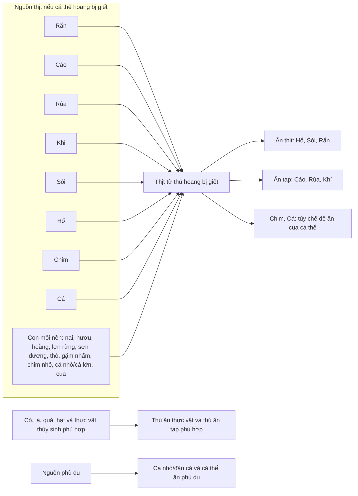
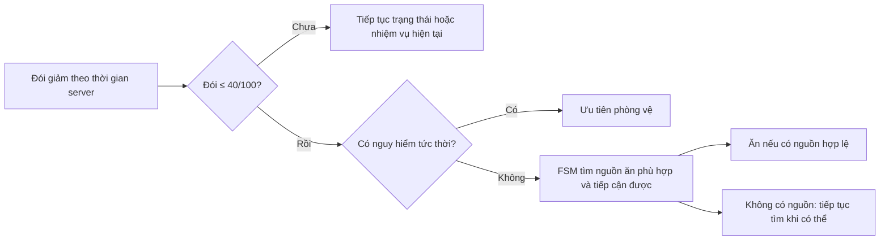

# Tiên Tộc Alpha 2.0 — Sơ đồ thức ăn

**Trạng thái:** Quan hệ thức ăn và ngưỡng bắt đầu tìm ăn đã được Product Owner xác nhận; số miếng thịt, lượng hồi Đói/Khát và sản lượng từ xác thú vẫn TBD.

Sơ đồ [chuỗi thức ăn do Product Owner cung cấp](../food_chain_diagram.drawio) ghi các quan hệ **có thể ăn**. Trong Alpha, áp dụng sơ đồ khái quát dưới đây: cả tám nhóm thú có thể chiêu mộ, khi còn hoang, đều có thể trở thành con mồi nếu bị giết. Mũi tên chỉ khả năng tạo/ăn thịt, **không** có nghĩa thú luôn tìm hoặc luôn tấn công loài ở đầu mũi tên. Khả năng giết được mục tiêu, tiếp cận nguồn thức ăn và chế độ ăn của cá thể vẫn phải hợp lệ.

## Quy tắc kích hoạt hành vi

- Ngưỡng **Đói ≤ 40/100** áp dụng cho mọi thú sống có thể tự kiếm ăn, gồm thú gia tộc, thú hoang và tầng con mồi; trong trạng thái `EVOLVING`, Đói đóng băng và không kích hoạt tìm ăn. Thú gia tộc vẫn tuân luật lấy thức ăn từ kho biệt viện khi chủ sở hữu offline; nếu không có thức ăn phù hợp thì tự kiếm bằng FSM. Thú hoang không lấy từ kho gia tộc.
- Không có đơn vị “bữa ăn” bắt buộc. Lượng Đói hồi khi dùng một đơn vị thức ăn, số đơn vị thịt từ từng xác và điều kiện kết thúc lượt tìm ăn cần chốt ở bảng cân bằng.
- Sơ đồ không áp đặt danh sách mục tiêu săn cố định. Việc chọn mục tiêu còn phụ thuộc trạng thái đói, vị trí, khả năng chiến đấu, nguy hiểm và nguồn thức ăn khác có sẵn. Không cấm săn cùng nhóm loài chỉ vì cùng nhóm.
- Thịt từ **thú hoang bị giết** là luật đã duyệt. Trường hợp thú đã gia nhập gia tộc chết và có trở thành nguồn thịt hay không chưa được chốt; không suy diễn từ sơ đồ này. Quy tắc vật phẩm rơi của thú gia tộc vẫn áp dụng.
- Cá và Rùa trong nước phù hợp có Khát đầy; thú cạn cần điểm nước ngọt hợp lệ. Các trị số lượng nước uống còn TBD.

Đối chiếu: [PRD](prd-alpha-2.0.md), [Gameplay Rules Catalog](gameplay-rules-catalog.md), [Balance Tables](balance-tables.md).
