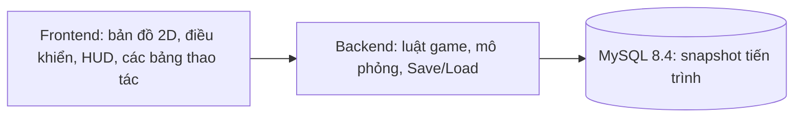
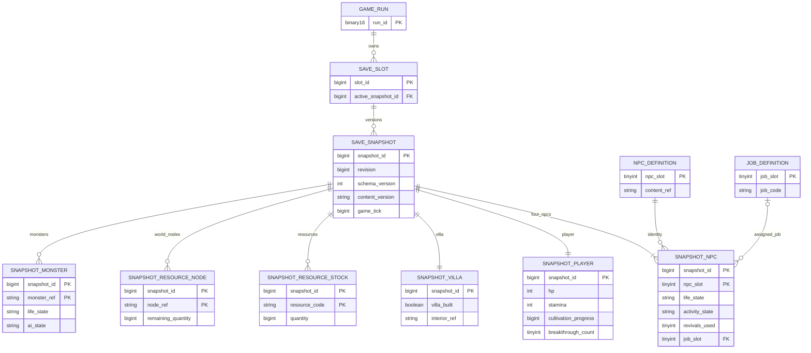
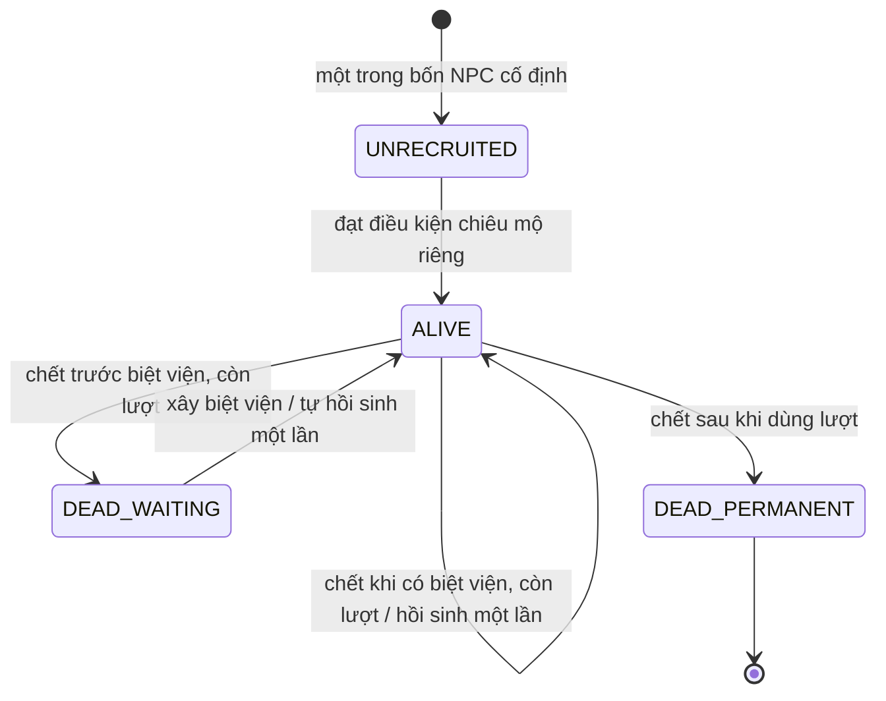

# System Design — Tu Tiên Gia Tộc, Demo A

**Nguồn chức năng:** [Scope Baseline Demo A v1.0 đã duyệt](scope-baseline-demo-a-v1.0.md).  
**Trạng thái:** thiết kế hệ thống để bắt đầu frontend và hoàn thiện chi tiết backend/database; không thay đổi scope gameplay.  
**Database mục tiêu:** MySQL 8.4, InnoDB. [DDL thiết kế](../database/mysql84-schema-draft.sql) chưa phải migration chạy production.

## 1. Ranh giới hệ thống



Frontend gửi thao tác và hiển thị trạng thái backend trả về. Backend quyết định HP, hồi đòn, truy đuổi, hành vi NPC, xây biệt viện, hồi sinh, Save/Load và kết quả. MySQL lưu trạng thái có thể khôi phục nhất quán. Đây là game single-player trên trình duyệt; **không mô phỏng tiến trình khi offline** (Baseline §8).

## 2. Ánh xạ yêu cầu vào thiết kế

| Nhóm | Yêu cầu/AC | Dữ liệu và trách nhiệm chính |
|---|---|---|
| Phiên chơi, bản đồ | FR-01, FR-02, AC-01 | Một `game_run`, phiên bản nội dung bản đồ, vị trí player/NPC/yêu thú/tài nguyên; frontend vẽ bản đồ 2D. |
| Tu luyện | FR-03, AC-02 | Một công pháp và cảnh giới khởi đầu ở nội dung tĩnh; snapshot lưu tiến trình tu luyện và `breakthrough_count` 0 hoặc 1. |
| Chiến đấu/yêu thú | FR-04, FR-05, AC-01, AC-03 | Backend xử lý tấn công chủ động, HP/hồi đòn và giới hạn truy đuổi quanh điểm sinh; snapshot giữ trạng thái đang chiến đấu. |
| NPC/chiêu mộ/công việc | FR-06, FR-08–FR-12, AC-04, AC-06–AC-09 | Đúng bốn NPC thiết kế thủ công; snapshot giữ cả NPC chưa gia nhập, việc, hoạt động, vị trí, lượt hồi sinh. |
| Tài nguyên/biệt viện | FR-07, AC-05 | Snapshot giữ lượng tài nguyên, các điểm tài nguyên đã khai thác và biệt viện; chi phí xây là tham số nội dung. |
| Người chơi chết | FR-13, AC-11 | Backend hồi sinh tại biệt viện hoặc kết thúc lượt chơi. |
| Save/Load | FR-14, AC-10, NFR-03, NFR-05, NFR-08 | Một snapshot giao dịch bao gồm cả combat/retreat, tài nguyên, tiến trình và world động. |
| Hoàn thành/thất bại | FR-15, FR-16, AC-12, AC-13, NFR-09 | Backend đánh giá lại sau Load; trả kết quả và cho phép bắt đầu lượt chơi mới khi thất bại. |

NFR-06 yêu cầu tránh kẹt di chuyển; NFR-07 yêu cầu điều khiển đủ mượt. Ngưỡng đo và thuật toán di chuyển là tham số kỹ thuật chưa chốt, không phải quyền mở thêm gameplay.

## 3. ERD và nguyên tắc dữ liệu



`npc_definition` có đúng bốn slot. Tính cách, lời thoại và điều kiện gia nhập là **nội dung tĩnh thiết kế thủ công** gắn với từng slot; chưa tự tạo nội dung đó. `job_definition` có đúng bốn mã: `GATHER` (thu thập), `CULTIVATE` (tu luyện), `GUARD` (canh gác), `HUNT` (săn yêu thú). Một NPC đã gia nhập có tối đa một `job_slot` chính.

Snapshot NPC còn giữ tiến trình tu luyện riêng và `job_area_ref` cho khu vực canh gác cố định. Snapshot biệt viện giữ vị trí xây và vùng nội thất. Các điều kiện gia nhập thủ công có thể cần thêm cờ tiến trình một lần sau khi nội dung bốn NPC được viết; chưa tạo cờ tùy ý khi điều kiện cụ thể chưa được duyệt.

Một `save_snapshot` là phiên bản bất biến của toàn bộ tiến trình động. `save_slot.active_snapshot_id` chỉ được đổi sau khi mọi bảng con đã ghi xong. `content_version` gắn snapshot với định nghĩa bản đồ, NPC, công pháp, điểm sinh yêu thú, phạm vi truy đuổi và chi phí xây dựng tương ứng. Không cam kết nâng dữ liệu Demo sang Alpha.

`snapshot_resource_stock` hiện biểu diễn một tồn kho tài nguyên chung của lượt chơi, vì baseline chưa quy định tài nguyên thuộc riêng player hay từng NPC. Đây là **lựa chọn dữ liệu kỹ thuật tạm thời**; không tạo cơ chế trao đổi hay kho NPC. Khi thiết kế nội dung tài nguyên được chốt, phải xác nhận mô hình sở hữu trước migration.

Các `CHECK` MySQL giữ ràng buộc trong một hàng; dịch vụ Save/Load kiểm tra ràng buộc liên bảng, số lượng đúng bốn NPC, vùng an toàn và vùng nội thất. [MySQL 8.4 CHECK](https://dev.mysql.com/doc/refman/8.4/en/create-table-check-constraints.html) không tham chiếu bảng khác. Khóa ngoại và [giao dịch InnoDB](https://dev.mysql.com/doc/refman/8.4/en/innodb-transaction-model.html) bảo vệ tham chiếu và công bố snapshot nguyên tử.

## 4. State machine NPC

Trạng thái **sinh tử/chiêu mộ** và **hoạt động** là hai chiều riêng. NPC chưa gia nhập chỉ đi trong vùng an toàn, không thể chết và không có công việc. NPC đã gia nhập có thể làm việc, nghỉ, rút lui, hồi phục hoặc chờ sau hồi phục. Các ngưỡng và thời lượng chờ là tham số kỹ thuật (§9 baseline).



| Sự kiện | Cập nhật nguyên tử của trạng thái game |
|---|---|
| NPC chưa gia nhập nhận nguồn sát thương | Không chết; vẫn ở `UNRECRUITED` trong vùng an toàn. |
| NPC đã gia nhập ở **bên trong** biệt viện nhận đòn | Không giảm HP, bất kể có đang nghỉ hay không (EX-04). |
| NPC chết trước biệt viện, chưa dùng lượt | `DEAD_WAITING`, HP=0, giữ việc, vị trí và `revivals_used=0` (EX-02). |
| Xây biệt viện | Hồi sinh mọi NPC `DEAD_WAITING` còn lượt trong cùng chuyển trạng thái: HP/thể lực đầy, `revivals_used=1`, giữ việc, nghỉ trước khi tiếp tục. |
| NPC chết khi đã có biệt viện, chưa dùng lượt | Tự hồi sinh ở biệt viện, HP/thể lực đầy, dùng một lượt, giữ việc, nghỉ trước khi tiếp tục. |
| NPC chết sau khi đã dùng lượt | `DEAD_PERMANENT`, HP=0, `job_slot=NULL` (EX-03). |
| Thể lực thấp hoặc HP dưới ngưỡng an toàn | Nghỉ hoặc rút lui; hồi phục đến ngưỡng, chờ thêm thời gian rồi về việc cũ. Nếu biệt viện tồn tại, rút lui ưu tiên về đó. |

Trong snapshot hợp lệ, `DEAD_WAITING` không đi cùng `villa_built=TRUE`, vì sự kiện xây đã tự hồi sinh NPC. Lúc Load, không tiêu lượt lần nữa. `rest_until_tick` là timer hoạt động, không quyết định miễn sát thương.

## 5. Người chơi và kết quả

Người chơi HP về 0: nếu có biệt viện, hồi sinh tại đó với HP/thể lực đầy, xóa mục tiêu chiến đấu (EX-05); nếu chưa có, kết thúc lượt chơi (FR-13). Không lưu người chơi HP=0 như checkpoint có thể tiếp tục.

Sau Load, backend tính lại trên trạng thái đã khôi phục (EX-06):

```text
completed = villa_built
            AND breakthrough_count >= 1
            AND count(NPC with life_state = ALIVE) = 4

if completed: COMPLETED
else if player died without villa, or any fixed NPC is DEAD_PERMANENT: FAILED
else if another impossibility can be proven from approved world/resource rules: FAILED
else: IN_PROGRESS
```

Vì bốn NPC là cố định và không có NPC thay thế, một NPC chết vĩnh viễn làm điều kiện bốn NPC sống không thể đạt. `DEAD_WAITING` trước biệt viện **chưa** đủ để kết luận thất bại. Các trường hợp cạn tài nguyên/không thể xây chỉ được kết luận khi mô hình tài nguyên cụ thể chứng minh được; không suy đoán từ một số lượng thấp.

Khi thất bại, frontend hiển thị thông báo và cho phép bắt đầu lượt chơi mới (FR-16); backend tạo `game_run` mới thay vì dùng trạng thái hỏng của lượt cũ. Baseline không yêu cầu giữ hay xóa lịch sử các lượt chơi cũ, nên chính sách lưu giữ là tham số kỹ thuật.

## 6. Save/Load

### Save

1. Khóa hoặc tạm dừng cập nhật của một lượt chơi để lấy **một ảnh trạng thái đồng nhất**, kể cả khi đang chiến đấu hoặc rút lui (FR-14). Ảnh gồm HP/thể lực, cooldown, combat target, vị trí, tiến trình tu luyện, bốn NPC, biệt viện, tài nguyên, node tài nguyên và yêu thú động.
2. Kiểm tra bất biến NPC, vị trí vùng an toàn/nội thất, lượng tài nguyên, `content_version` và tham chiếu. Lỗi công việc NPC phải được cô lập theo NFR-08: chỉ công bố snapshot hợp lệ; nếu chưa thể khôi phục lỗi, từ chối Save và giữ bản lưu trước đó nguyên vẹn.
3. Trong **một giao dịch InnoDB**, khóa save slot, tạo revision mới, ghi toàn bộ bảng con, kiểm tra đủ hàng, cập nhật con trỏ active, rồi `COMMIT`. Lỗi thì `ROLLBACK`; con trỏ cũ còn nguyên (NFR-03, NFR-05).

### Load

1. Đọc con trỏ active và mọi hàng cùng snapshot/revision trên ảnh đọc nhất quán; kiểm tra `schema_version`, `content_version`, đủ bốn NPC và các bất biến. Snapshot thiếu/sai bị từ chối; runtime hiện tại không thay đổi nửa chừng.
2. Dựng runtime tạm từ snapshot. NPC `UNRECRUITED` giữ trong vùng an toàn. NPC `DEAD_WAITING` giữ trạng thái, vị trí, công việc và lượt. NPC `DEAD_PERMANENT` chỉ giữ bản ghi, không chạy việc.
3. Với NPC **đã gia nhập và còn sống**: snapshot có biệt viện thì đặt ở biệt viện và giữ việc cũ; chưa có biệt viện thì giữ vị trí đã lưu (EX-01). Không sửa snapshot gốc. Timer nghỉ không tiến khi offline.
4. Khôi phục trạng thái chiến đấu/rút lui của player, NPC và yêu thú. Kiểm tra mục tiêu chiến đấu còn tồn tại/hợp lệ; tham chiếu vô hiệu không được gây kẹt hoặc lỗi Load. Vị trí NPC được chuyển về biệt viện có thể khiến đường đi hoặc mục tiêu cũ không hợp lệ; backend dựng lại hoạt động từ `job_slot` đã lưu.
5. Chạy evaluator ở §5 **sau** khi dựng xong; thay runtime đang chạy chỉ khi toàn bộ Load thành công. Trả kết quả cho frontend để hiển thị thắng/thua đúng (NFR-09).

Load snapshot cũ trước khi xây biệt viện khôi phục thế giới **chưa có biệt viện**, nên NPC giữ vị trí/chết-chờ của snapshot đó. Khi Save sau khi xây, snapshot mới có biệt viện; Load snapshot mới đưa NPC sống về biệt viện. Cơ chế người chơi chọn revision cũ chưa được baseline quy định; quy tắc này chỉ nói cách xử lý nếu snapshot đó được chọn.

## 7. Dấu vết EX và nghiệm thu

| Quyết định | Dữ liệu/chuyển trạng thái | Ca thiết kế trong [hợp đồng Save/Load](save-load-contract-demo-a.md) |
|---|---|---|
| EX-01 | Vị trí NPC và `villa_built` | SL-01, SL-04, SL-05 |
| EX-02 | `life_state`, `revivals_used`, xây biệt viện | SL-02, SL-03 |
| EX-03 | `job_slot=NULL` khi chết vĩnh viễn | SL-07 |
| EX-04 | Kiểm tra vùng biệt viện trước sát thương | SL-06 |
| EX-05 | PlayerDeath và `combat_target_ref` | SL-08 |
| EX-06 | Evaluator sau Load | SL-12, SL-13 |

## 8. Tham số kỹ thuật cần chốt, không phải gameplay mới

| Tham số | Ảnh hưởng |
|---|---|
| Ngưỡng HP/thể lực, thời gian nghỉ và chờ sau hồi phục | State machine hoạt động NPC, NFR-07. |
| Phạm vi truy đuổi, điểm sinh yêu thú, vùng canh gác, vùng săn | Di chuyển/AI và AC-01, AC-07. |
| Chi phí xây biệt viện, loại và lượng tài nguyên/điểm tài nguyên | FR-07, AC-05, đánh giá “không còn khả năng”. |
| Ranh giới vùng an toàn/biệt viện, điểm đặt NPC sau Load/hồi sinh | FR-11, EX-01, EX-04, NFR-06. |
| Game tick, tốc độ cập nhật, cooldown và ngưỡng đo mượt | FR-04, NFR-07, Save/Load trong combat. |
| Cách đồng bộ trạng thái thời gian thực giữa frontend/backend | FR-02/04, NFR-07; chốt giao thức và nhịp cập nhật trước tích hợp. |
| Số save slot, giữ revision, phiên bản nội dung, xử lý target mất sau Load | NFR-03, NFR-05, NFR-09. |
| Nội dung thủ công của bốn NPC, công pháp, cảnh giới, bản đồ | Tài sản nội dung đã nằm trong scope; cần file dữ liệu/thiết kế riêng trước khi hoàn thiện gameplay. |

Các tham số trên cần được chọn và kiểm thử trong giai đoạn thiết kế kỹ thuật. Mọi thay đổi **luật chơi** so với [baseline khóa](scope-baseline-demo-a-v1.0.md) cần đánh giá tác động và duyệt riêng.
